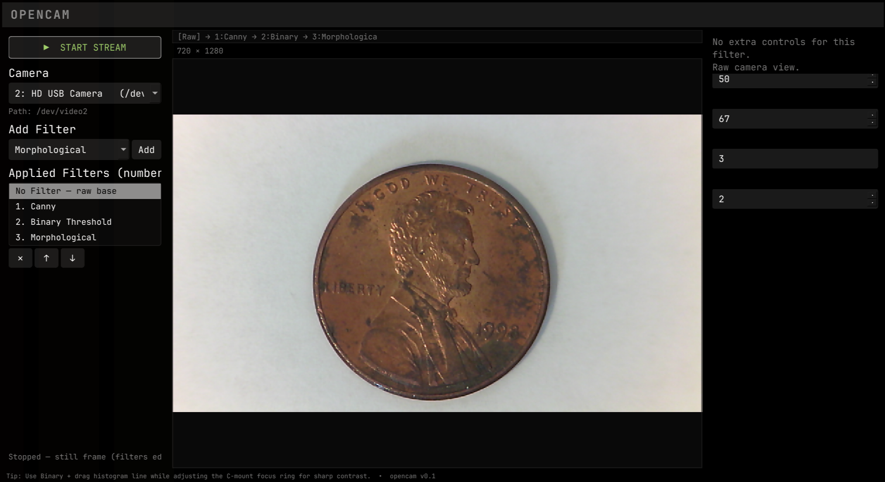
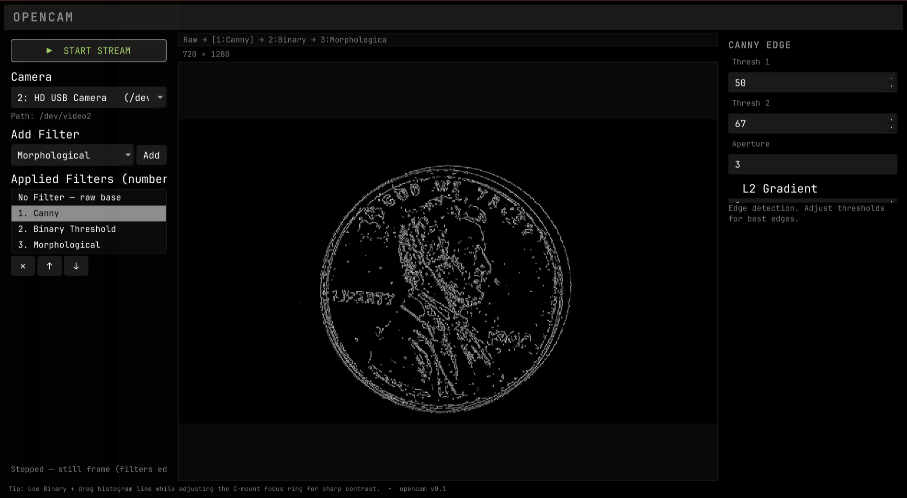
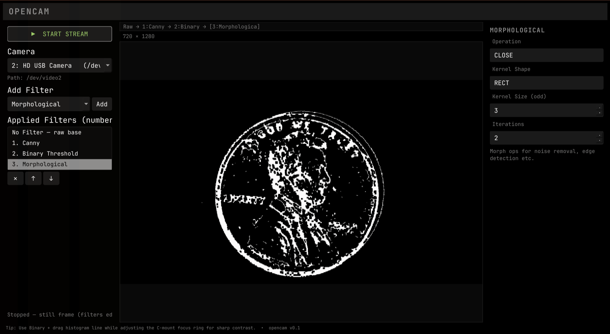
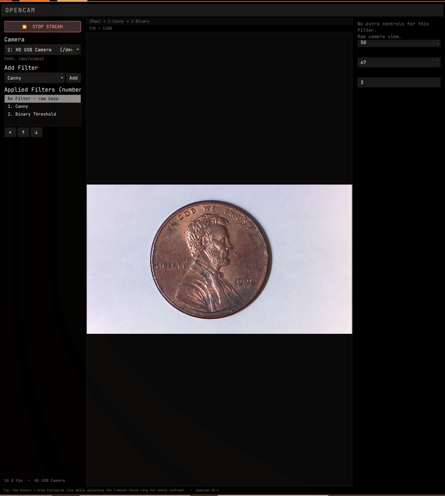

# opencam — v0.1

Beautiful, clean Omarchy-style tool for setting up USB webcams with manual C-mount lenses.

Live preview of the camera feed with a stackable, numbered filter pipeline to help visually tune focus, alignment and aperture using the mechanical lens ring.

Stopping the stream freezes the last frame — filters stay fully editable on the still image (add, reorder, remove, tune params), so you can keep working without the camera running.

## Screenshots

C-mount lens setup on Penny — the same frame through different pipeline stages:

**Raw base (No Filter)**



**Canny stage**



**Morphological stage**



**App view**



## Requirements

- Linux with V4L2 cameras (`/dev/video*`; `v4l2-ctl` from `v4l-utils` recommended for USB camera names)
- Python 3.10+
- PyQt6, OpenCV, NumPy (see `requirements.txt`)

## Quick start (Omarchy / any Linux)

```bash
git clone https://github.com/jc-9/opencam.git
cd opencam
./install.sh
```

`install.sh` picks the best dependency route for your machine (native system
packages when present, otherwise a venv with `--system-site-packages`), installs
the desktop entry + icon into `~/.local`, and prints a confirmation. Then search
**opencam** in your app launcher. No sudo needed.

Camera note: your user must be able to read `/dev/video*` (on most distros
that means membership in the `video` group; check with `groups | grep -o video`).

A C++ port (optional/experimental; needs Qt6 dev headers) lives in `cpp/` —
see `cpp/README.md` to build it with `./cpp/build.sh`.

### Manual install (no install.sh)

```bash
python3 -m venv --system-site-packages venv
./venv/bin/pip install -r requirements.txt
./run.sh
```

## Controls (all inside the single window)

Menus live in a left sidebar (vertical stack, ready for more dropdowns):

- **▶ START STREAM / ⏹ STOP STREAM** — toggle (full-width in sidebar)
- **Camera** dropdown — auto-detected V4L2 (USB first). Shows **Path: /dev/videoX** explicitly below it. Robust autodetection via v4l2-ctl + fallback.
- **Add Filter** dropdown + **Add** button — appends a filter to the pipeline
- **Applied Filters** list — unnumbered `No Filter — raw base` pinned at the top (the raw frame every stack starts from; not a choice, can't be moved or removed), then numbered filters: "1. Gaussian Smoothing", "2. Binary Threshold", ... Select an entry to edit it in the right panel; **✕ / ↑ / ↓** buttons remove / reorder it (nothing can move above the raw base).
- **Numbered pipeline label** above the preview — "Raw → 1:Gaussian → [2:Binary] → 3:Sobel" shows the applied order on screen; brackets mark the viewed stage.
- Clicking a stage previews the **cumulative result up to that stage**: click 3 → effects of 1→2→3, click 2 → 1→2, click 1 → only 1. Works live and on the frozen still frame.
- Filters apply sequentially (each stage's output feeds the next). The histogram shows the input of the selected binary stage.
- Dynamic right panel (follows same layout convention; restores saved params when you reselect a stage):
  - Binary Threshold: threshold input field + mini live histogram with draggable red threshold line
  - Gaussian Smoothing: Kernel Size + Number of passes (1-5)
  - Sobel X: kernel size controls (3/5/7)
  - Image Color: Mode (Color / Greyscale)
  - Morphological: operation, kernel_shape, kernel_size (odd 3-21), iterations
  - Canny: thresh1/2, aperture, L2gradient
  - Median Blur: kernel_size (odd 3-15)
  - Bilateral Filter: d, sigma_color, sigma_space
  - Color Threshold: color_space (HSV/LAB/YCrCb), lower/upper per channel, invert
  - Rotate Image: angle in degrees (counter-clockwise; exact 90°/270° steps transpose the canvas, other angles keep it)
- **Size readout** under the pipeline label — current image size as height × width (e.g. `720 × 1280`), updating for every viewed stage since filters like Rotate can change it

Fully compatible with current Omarchy theme (loads colors.toml at runtime, applies to palette + QSS). Switch themes then restart app to pick up new colors.

## Run

```bash
./run.sh
```

Or directly:

```bash
./venv/bin/python app.py
```

## App menu (Omarchy / Hyprland)

`./install.sh` handles the launcher entry (with its own icon, `opencam.svg`:
camera glyph + "open" wordmark in Omarchy theme colors) — search **opencam**
in the app launcher (Walker) after installing. To re-do it manually, re-run
`./install.sh` (idempotent); don't copy `opencam.desktop.template` by hand,
it contains an `@INSTALL_DIR@` placeholder the installer fills in.

## Stack

- PyQt6 (styled to match Omarchy theme palettes via colors.toml)
- opencv-python-headless + numpy
- Single live view + right dynamic params panel
- Left sidebar for controls (expandable for future dropdowns)
- Explicit camera device path display

## Verification

- Live-verified on V4L2 hardware: streaming + FPS, full filter stack, rotate 90° size transpose, camera switch restart, stop → still-frame editing, launcher relaunch
- Fresh-clone install simulation: venv fallback route, generated desktop entry (`desktop-file-validate` clean), icon install, app boot
- Multi-filter pipeline: add/select/reorder/remove stages; numbered list + on-screen pipeline label; sequential worker chain; param restore on reselect (60+ check offscreen suite, includes prior-crash repro scenario)
- Camera enumeration + path
- Theme colors loaded from active Omarchy theme
- Sidebar + clean layout, no overlaps
- CIFS safe
